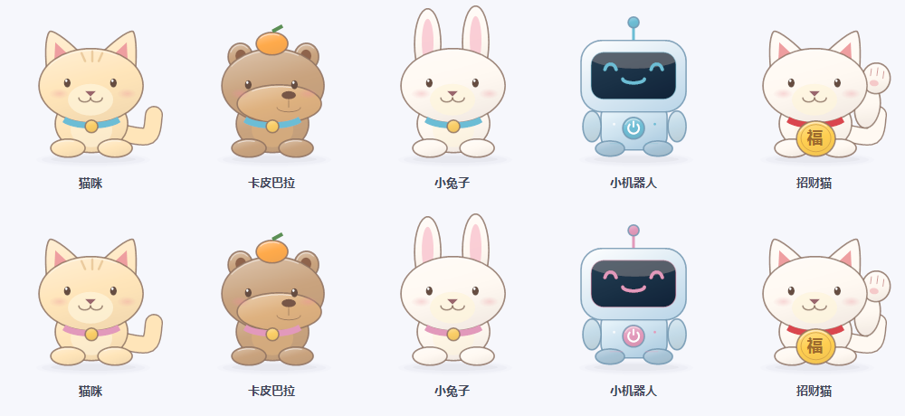
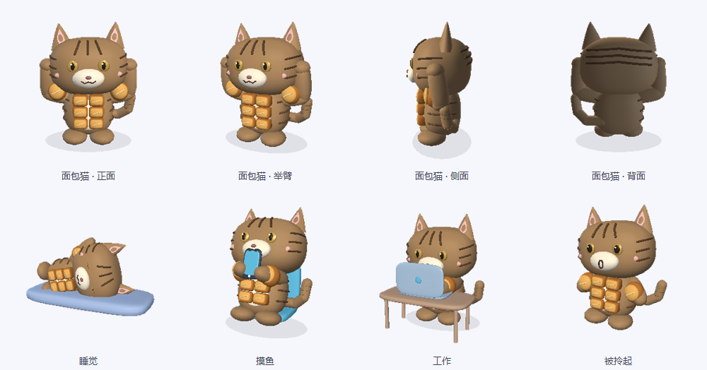
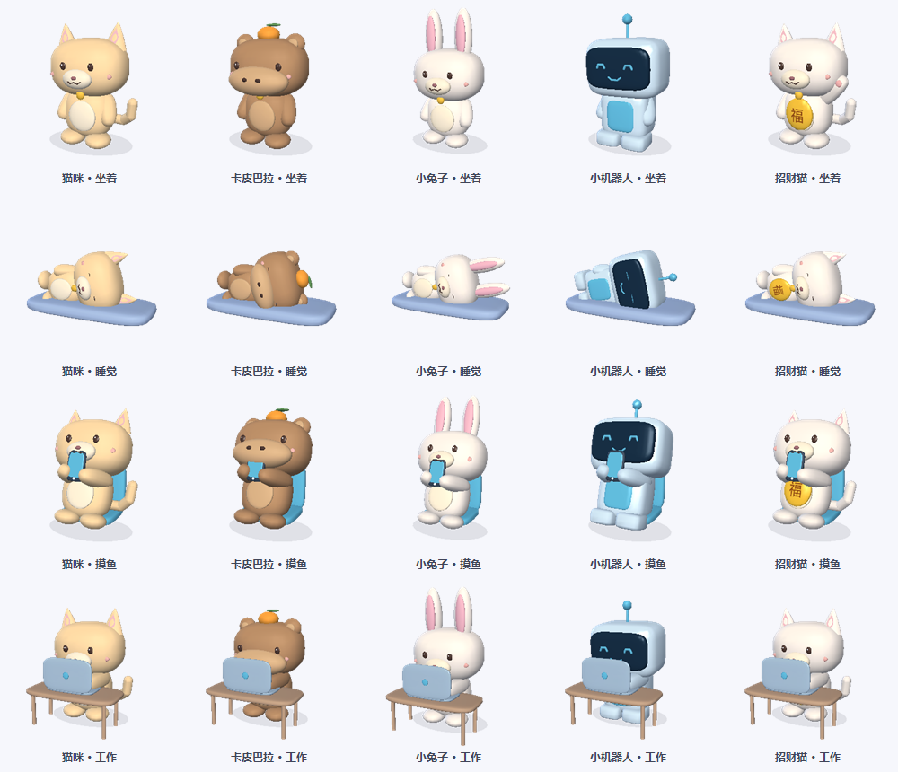
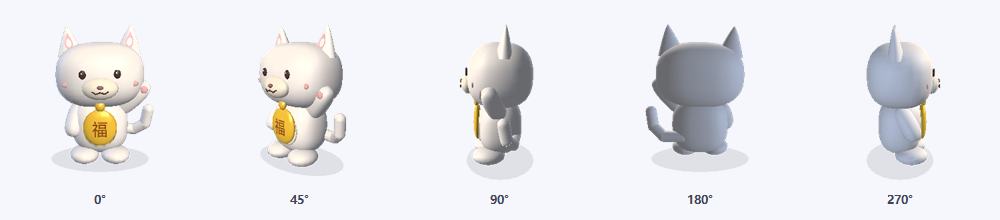
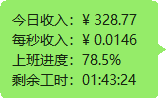
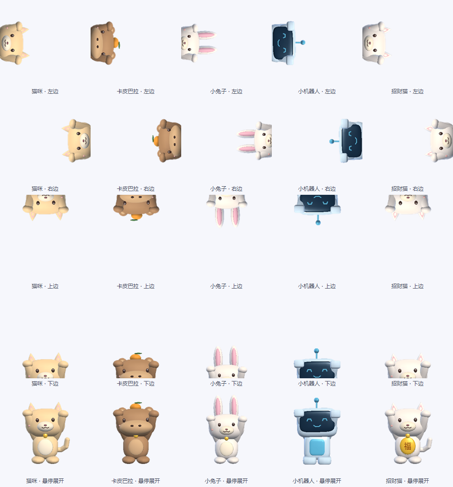
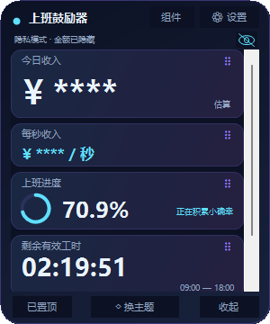
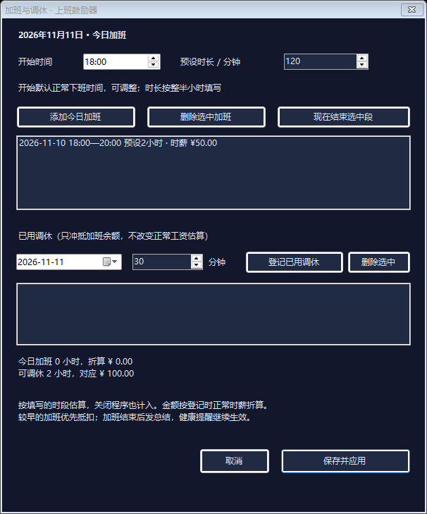
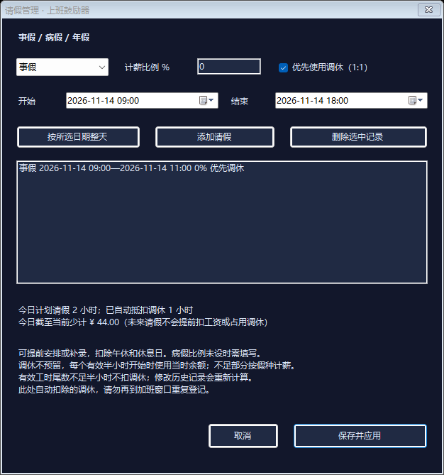

# 上班鼓励器

Windows 三维桌宠与可配置详情面板，显示当天上班进度、剩余有效工时和按月薪折算的收入，支持喝水与如厕提醒。



新增的面包猫采用虎斑公仔造型，带六块烤面包腹肌和面包上臂，坐着时双臂举起。右键桌宠 → 切换桌宠形象 → 面包猫，或在设置中选择；支持旋转、四种状态、贴墙、缩放及被拎起动作。







| 霓虹科技 | 樱粉星光 |
| --- | --- |
|  |  |

截图使用演示月薪，不包含实际个人配置。

## 功能

- 猫咪、卡皮巴拉、小兔子、小机器人、招财猫、面包猫六种真实三维桌宠，采用圆润公仔比例、网格曲面和灯光材质；招财猫会举爪招手。
- 左键拖动移动，右键拖动旋转视角，可查看模型侧面和背面，视角自动保存。
- 拖到屏幕可用区域四边附近松手，桌宠会贴墙探头，只露出半个头和爪子；鼠标移上去完整探出，移开缩回，拖离边缘恢复原来的姿态。
- 桌宠大小可在设置中连续调节 50%–150%，默认 100%；按所在显示器缩放调整，副屏断开或工作区变化后自动回到可见位置。
- 详情顶部的小眼睛、右键菜单和 Ctrl+Alt+P 可切换隐私模式，统一隐藏收入与下班总结金额，记住状态；设置页的月薪可主动查看。
- 可选择登录 Windows 后自动启动，默认关闭；启用时使用当前程序路径，不随分享配置传播。
- 左键实际拖动角色时进入被拎起的临时姿态：身体轻摆、反向歪头、交替晃腿和小幅挣扎，眼睛与嘴巴随动作变化；松手过渡回原状态。六种桌宠均支持，轻点和右键旋转不触发。
- 坐着、睡觉、摸鱼、工作四种状态，默认每10–20秒随机切换，也可在右键菜单手动指定。姿态只影响动画，不影响工资或提醒判定。
- 点击桌宠展开或收起详情。八个详情组件可勾选显隐、拖动排序并记住配置，内容较多时可滚动查看。
- 今日加班可预设开始与时长，按完成的整半小时累计为可调休时长及正常时薪折算金额；登记已用调休时按较早加班记录优先抵扣。
- 事假、病假、年假支持自定义计薪比例、提前安排与补录、多段和连续多天；按实际请假时段调整正常收入，暂停健康提醒，可优先使用当时已有调休。
- 鼠标停留在桌宠上约半秒，显示实时信息气泡，移开自动收起；点击展开的详情保持显示。悬浮内容可独立勾选，不改变详情组件配置。
- 喝水、如厕和下班总结使用桌宠旁的绿色聊天气泡，尖角朝向角色；点击关闭，15秒自动收起，拖动桌宠时气泡跟随。
- 自定义月薪、上下班时间和午休时间。
- 单休、双休、大小周；按当月日历统计工作天数，也可手动覆盖当月天数。
- 当天收入估算、每秒收入、环形进度和剩余有效工时；挂件不展示月薪或日薪目标。
- 霓虹科技与樱粉星光双主题。
- 紧凑版 300×360、迷你版 260×300，在设置中切换并记忆。
- 拖动、置顶、收进托盘；双击托盘图标恢复。
- 喝水、如厕分别设置 1–1440 分钟的提醒间隔，各自到期提醒；可只启用其中一项，同时到期合并弹窗。
- 提醒午休暂停，下班和休息日静默；弹窗不抢焦点、不发声，15 秒自动关闭。
- 下班弹窗汇总当天估算收入；当天晚些时候打开会补发一次，重启不重复，可在设置中关闭。

## 使用

需要 Windows 和 .NET Framework 4.x。正常的 Windows 10/11 系统通常已自带所需运行环境。

在本仓库的 Releases 页面下载免安装 ZIP，完整解压到有写入权限的目录，双击 `上班鼓励器.exe`。首次运行填写月薪与作息，保存后生效。提醒默认关闭，需要在设置中启用；可点击“预览提醒”试用。

默认显示桌宠。左键拖动调整位置，右键拖动旋转视角，单击角色打开详情；点击详情顶部的“组件”勾选要查看的模块，在卡片上拖动可调整顺序。右键轻点可切换形象、选择状态、重置视角、打开设置或退出；不启用桌宠模式时可继续直接使用详情面板。

右键桌宠或托盘图标，选择“配置悬浮信息”，可开启或关闭悬浮预览，并独立选择今日收入、每秒收入、上班进度、剩余有效工时、鼓励语、本月累计、加班与调休、请假记录。默认显示前四项，不显示月薪；全部取消勾选时不弹出预览。悬浮信息每秒更新，拖动、旋转和操作菜单时暂停显示，喝水、如厕和下班提醒优先显示。点击详情后，鼠标移开不会将详情关闭。



三维部分使用系统自带的WPF透视相机、MeshGeometry3D网格和材质。模型由程序生成，当前角色与视角的循环动画帧会缓存；旋转相机或更换角色时重新渲染。首次生成新视角动画的开销高于重复播放，其他电脑的实际流畅度取决于配置。

拖动桌宠到可用屏幕边缘约 24 像素以内松手即可贴墙，四边都支持，角落按最近的一条边吸附。贴墙使用正面抬爪姿态，暂停散步和随机状态切换；鼠标悬停时完整探出，移开后缩回，拖离边缘恢复原来选择的状态和视角。点击详情、悬浮信息与提醒仍然可用；贴墙方向和位置会保存。角色只在自己的透明窗口内裁切，不移到屏幕外，也不会跨到相邻显示器或藏到任务栏后。



在设置中分别填写喝水、如厕间隔（分钟），例如 30 和 60，各自到期提醒，同时到期合并成一个弹窗。旧配置的间隔默认各 30 分钟，原先的双项交替模式改为分别计时。

下班收入总结默认开启，可在设置中关闭；当天晚些时候打开会补发一次，同日重启不会重复。

在设置中勾选“登录Windows后自动启动”并保存，才会注册当前程序；取消勾选并保存即可关闭。该选项属于当前电脑，不写入 `settings.xml`。程序移动目录后，请在新目录运行，并重新取消、勾选后保存以更新路径。首次运行和分享包默认不会注册启动项。右键挂件或托盘图标，选择“退出”可完全关闭。

点击详情顶部的小眼睛切换隐私模式，也可以使用右键菜单或 Ctrl+Alt+P。开启后，今日收入、每秒收入、悬浮信息和下班总结统一隐藏金额，进度和计时继续显示，工资计算及提醒时间不变；已打开的总结也会立即遮住金额。设置页的月薪默认隐藏，点击“查看”才显示，重新进入设置会再次隐藏。隐私模式只影响显示，配置文件仍保存原有薪资。若快捷键已被其他程序占用，会提示使用小眼睛或菜单切换。




拖动动画按经过时间过渡，鼠标消息频率不影响切换速度；实际拖动时暂时隐藏工作桌、手机和睡垫，松手后恢复原来选择的状态。动画只改变角色绘制，不延迟窗口跟随鼠标，也不修改收入、提醒或隐私设置。拖动被打断时会自动退出被拎起状态。

设置中的“桌宠大小”只改变角色，详情面板的紧凑/迷你选项保持独立，保存后生效。桌宠在 Windows 10 支持的每显示器 DPI 模式下跟随屏幕缩放；旧系统使用兼容缩放。位置修复依据当前可用屏幕工作区，保留四边贴墙方向。不同缩放比例的多屏环境仍建议在自己的设备上核实效果。

## 计算规则

右键桌宠或托盘 → **今日加班 / 调休**，设置当天工作日正常下班后的加班，时长按30分钟递增，可分多段添加。点击“现在结束选中段”可提前结束正在进行的加班，最后点击“保存并应用”生效；本版不支持休息日或跨午夜加班。记录按填写的时段估算，程序关闭时也会累计，每段不足整半小时的尾数不计入。

每条加班记录保存登记时的正常时薪（当日正常日薪 ÷ 有效工作小时），之后改月薪不会改变历史折算金额。加班同时体现为可调休时长和对应金额，不合并到正常的今日收入、本月累计，也不代表已支付现金。登记已发生的调休日期与分钟数后，较早的加班先抵扣，其对应金额同步减少。例如2小时、折算100元，使用1小时后剩1小时、50元；不足余额、重叠时段和跨午夜时段会被拒绝。

保存后显示独立的“加班与调休”组件，也可通过组件菜单显隐、排序，并加入悬浮信息。开启隐私模式时，组件、加班设置、悬浮及总结中的金额统一隐藏。这个窗口的“登记已用调休”只冲抵加班余额；按时段调整正常工资及暂停提醒，请使用“请假管理”。同一次请假已自动抵扣调休时，不要再手动重复登记。

有加班计划时，下班总结等当天最后一段结束后发送；提前结束也会相应提前。同日已发总结后再延长加班，会在新的结束时间再总结一次；健康提醒在加班时继续累计，在加班间歇及最终结束后暂停。保存设置会重置健康提醒计时。




右键桌宠或托盘 → **请假管理**，选择事假、病假或年假，填写起止日期和时间、计薪比例，添加后点击“保存并应用”。事假初始比例0%、年假100%；病假首次使用必须自行填写，之后记住最近使用的比例。每次登记都可修改比例，已经登记的记录保留当次比例，不是法定或公司计薪规则的自动判断。

请假以整半小时登记，支持提前安排、补录、同日多段和连续多天，单条最长366天；不同记录不能重叠。“按所选日期整天”会使用当前上下班时间。实际请假时长只包含所选休息制下的正常工作时间，排除午休、夜间和休息日。自定义作息、午休边界截出的不足半小时有效尾数仍按所选比例计薪，不消耗零碎调休。

勾选“优先使用调休（1:1）”时，未来请假不预留余额；到每个有效半小时开始时，再使用当时已完成加班形成的30分钟余额，较早加班优先。覆盖部分正常计薪，不足余额的部分按本次假种比例计薪。后来的加班不会倒补过去未覆盖的请假。调休时长及对应金额同步扣减，例如2小时、100元，实际抵扣1小时后剩1小时、50元。旧版手动登记的已用调休仍保留；删除或补录历史记录会重新结算。

请假期间暂停喝水、如厕计时与弹窗，恢复上班后接着计算实际工作时间；带薪假也暂停提醒。原来的上班进度与下班倒计时仍按作息显示，加班收入保持独立，下班总结增加今日请假及自动调休时长。

新增“请假记录”组件，显示今日计划请假、已自动抵扣调休和截至当前的收入扣减，可勾选显隐、拖动排序、加入悬浮信息。隐私模式统一遮住扣减金额，包括已打开的请假窗口。修改记录可删除后重新添加，取消窗口不会保存草稿。




当天估算收入 = 月薪 ÷ 当月工作天数 × 当天有效工时进度 − 今天已发生请假的未计薪部分，最低为零。

本月累计先按月薪 ×（本月已过的工作日数 + 今天的有效工时进度）÷ 当月工作天数计算并封顶到月薪，再减去本月已发生请假的未计薪部分，最低为零。未来请假不会提前扣工资。休息日保留此前累计，午休暂停增加，程序未打开的工作日也计入；跨月自动重新计算。修改月薪、作息或休息制会按当前配置重算本月估算，不保存历史月份工资流水。手动指定的工作天数多于日历工作日时，月末累计可能低于月薪。

在详情顶部的“组件”中勾选“本月累计”，可拖动排序；右键 → 配置悬浮信息也可选择该项。升级保留原来的显隐和排序，新项追加到排序列表。隐私模式会同时遮住月累计金额。


午休不计工时；上班前为零，下班后以扣除请假未计薪部分的日薪为上限。关闭后重新打开会依据当前本机时间重新计算。

自动工作天数的分母只考虑所选休息制，不自动识别节假日，也不因请假、调休或加班改变；已登记的请假另行影响计薪。手动覆盖只修改日薪分母，并且仅对当月生效；每日是否上班仍按休息制判断。支持同一天内的班次。

收入是时间折算值，并非实际工资结算；只计算已登记请假的计薪影响，不计算税费、补贴或其他扣款。提醒在程序运行时有效，退出后停止；重启或保存设置后重新计时，不补弹错过的提醒。

## 从源码编译

使用 C# 和 Windows Forms，不需要安装第三方依赖。在 Windows PowerShell 中，从仓库根目录执行：

```powershell
.\src\Build.ps1
```

脚本使用系统 .NET Framework 的 C# 编译器，生成根目录下的 `上班鼓励器.exe` 和 `app.ico`。

## 验证

项目包含自动检查，覆盖收入边界、每秒收入、大小周、配置保存、主题、尺寸切换、自定义提醒间隔、下班总结去重、组件拖放、显隐配置、独立悬浮预览与原生透明桌宠窗口，以及请假比例、半小时调休FIFO、未来不预留、跨日跨月和请假期间提醒暂停。

自检会在可执行文件所在目录写入测试配置，请复制到独立目录执行，避免覆盖自己的设置：

```powershell
New-Item -ItemType Directory -Path .\work\verification -Force
Copy-Item .\上班鼓励器.exe,.\app.ico .\work\verification
Start-Process .\work\verification\上班鼓励器.exe -ArgumentList '--self-test' -Wait
Get-Content .\work\verification\test-report.txt
```

## 个人配置

配置仅保存在程序同目录的 `settings.xml`，修改时保留 `settings.xml.bak`。这些文件包含个人月薪、加班、调休和请假记录，已加入 `.gitignore`，请勿手动上传或放进分享包。

分享时使用不含个人配置的原始 ZIP。
